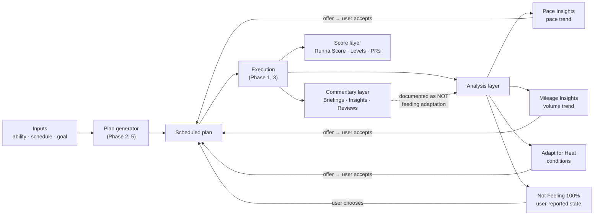

# Runna — Insights & Adaptation: How the Loop Actually Closes

**Subject:** Runna iOS app (`com.runbuddy.prod` v8.59.0), adaptive engine, AI commentary,
progress scoring, execution affordances
**Evidence:** Runna's public help centre — **31 articles** drawn from the *Training Hub*,
*App Features* and *Injury* collections, fetched and archived complete (see §1 and
`support/insights_articles.md`). These are the §11 open leads of
[`RUNNA-PLAN-MANAGEMENT.md`](./RUNNA-PLAN-MANAGEMENT.md).
**Companions:** [`RUNNA-UX.md`](./RUNNA-UX.md) ·
[`RUNNA-PLAN-GENERATION.md`](./RUNNA-PLAN-GENERATION.md) ·
[`RUNNA-PLAN-EXECUTION.md`](./RUNNA-PLAN-EXECUTION.md) ·
[`RUNNA-PROGRESS-AND-REVIEW.md`](./RUNNA-PROGRESS-AND-REVIEW.md) ·
[`RUNNA-PLAN-MANAGEMENT.md`](./RUNNA-PLAN-MANAGEMENT.md)
**Screens:** none — this phase is documentation, not captures

---

## 1. Method, and what kind of evidence this is

Same evidence class as Phase 5, same caveats, so this restates them once and moves on.
Help-centre text is **Runna's own description of what the app is supposed to do**. It
reveals rules, limits and state machines that no amount of screen recording would surface;
it cannot reveal whether the UI matches the claim. Every rule below is **"as Runna
documents it"**, not "as verified on device".

**Coverage.** Phase 5 crawled one collection (28 plan articles). Phase 6 enumerated all
**nine** collections Runna exposes — 550 unique article links across them
(`support/all_collections_index.json`) — and diffed against the 28 already archived. From
the ~514 remaining, 31 were selected as the ones that close an open lead or document an
algorithm, and all 31 fetched clean:

- `support/phase6_targets.json` — the 31 URLs with the lead each one was chosen to close
- `support/insights_raw.json` — structured extraction (headings, paragraphs, list items,
  tables, images, videos) for all 31
- `support/insights_articles.md` — the same rendered as readable text, 1,643 lines,
  numbered **[01]–[31]** with URLs (§13 has the key)
- `support/to_md_insights.cjs` — the converter
- `support/quote_audit.mjs` — re-runnable check that every quoted span in this doc is
  verbatim corpus text (`node quote_audit.mjs`, 106 spans, all passing)

Two collection-level caveats worth recording, because they bound what "complete" means
here. *App Features* reports **94 articles but renders 73** with no pagination marker in
the HTML; the enumeration is therefore a floor, not a census. And Runna publishes
**two live articles with the same name** (*"What Are Pace Insight Recommendations…"* [02]
and *"What are Pace Insights…"* [08]) whose wording differs in ways that matter — §10.

**What this phase closes.** Phase 5 §11 listed nine open leads. All nine are answered
below, and one Phase 3/4 question (the Riegel exponent) resolves in an unexpected
direction — the docs disclose no formula at all (§4).

---

## 2. The shape of the system

Six phases of evidence now describe one architecture, and it is worth stating plainly
before the detail, because it is the finding that the earlier phases could only infer:

Three properties of that diagram are the load-bearing findings:

1. **Every adaptation is an offer, not an action.** All four adaptation paths require an
   explicit accept. Runna says this outright about the pace loop: *"Pace Insights never
   automatically change your training paces without your input"* [08].
2. **The commentary layer is documented as deliberately decoupled from the adaptation
   layer.** The AI writes about your run; it does not change your next one (§9). This
   contradicts what the marketing framing of "AI coaching" implies and is the single most
   useful thing this corpus establishes.
3. **The score layer is a read-out of estimated race time, not an adherence composite**
   (§5). Runna's own worked example proves it.

---

## 3. The pace-adaptation engine (Pace Insights)

Four articles cover this: [02], [08], [19] (chart), [20] (ineligibility). Together they are
a near-spec.

### 3.1 What is analysed

Eligible workouts, listed in [20]: **Intervals · Tempos · Time Trials · "Some Long Runs
that have pace targets (i.e. structured long runs)"**. The older article [02] says only
*"Intervals, tempo runs and time trials"* — the long-run inclusion appears only in the
newer pair. [08] adds a further exclusion: walk/runs — *"No walk runs are not eligible for
pace insights."*

The analysis is **per-rep, not per-session**. From [19]:

> We plot your five most recent eligible speed workouts. For each workout, we highlight
> your fastest and slowest rep. […] We normalise paces across all reps in each workout, so
> you can compare your performance throughout the session even when rep distances or
> planned speeds vary.

And the data-quality stance, also from [19]:

> We ignore outlier reps that don't look right, so your chart may not fully match the reps
> shown in your completed workout.

Silent removal of outliers, and the user is told only on request, in an FAQ. Compare §11.1:
Runalytics skips an entire unsynced or unmeasurable session rather than trimming reps inside
a measured one — a coarser but *auditable* choice.

### 3.2 The five statuses

Identical wording in [02] and [08]:

| Status | Documented meaning |
| --- | --- |
| **Pace on Point** | *"You're perfectly on track with your plan."* |
| **Ahead of the Pack** | *"You're ahead of your plan. Tap 'View update' to see your recommended pace change."* |
| **Let's Review Your Pace** | *"A pace decrease may make training more effective and enjoyable."* |
| **Variable Pace Detected** | *"We can't make a recommendation just yet as your results have been mixed."* |
| **Monitoring Your Pace Data** | *"We don't have enough data yet."* |

Two of the five are **abstain states**, not verdicts. That is the honest design: the system
reports insufficient or contradictory evidence instead of manufacturing a trend. Note also
that the downward status is framed as a *benefit* ("more effective and enjoyable"), never as
a failure — the same tone discipline Phase 5 found around deload weeks.

### 3.3 The band is a trend, not a verdict on one run

[19] answers the question a user would otherwise ask the app every week:

> Pace Status bands are calculated from consistent efforts over time. You may receive a pace
> adjustment if you're repeatedly missing or beating your target paces overall, even if you
> hit your pace targets during your most recent workout.

A trailing window, then — [08] says *"If Pace Insights spots a consistent pattern between
eligible sessions"* — and the chart window is five workouts. Runalytics uses eight
(`LOOKBACK`, `pacing.rs:49`); Runna's is a display window and may not be the decision
window, so the docs do not actually pin their horizon.

### 3.4 Accepting changes exactly one thing

Both articles carry the same sentence, and it is the promise that makes the loop
trustworthy: *"Yes, but the only thing that will change is your pace targets!"* [02][08].
[08] generalises it: *"The only way your plan adapts is via Pace Insights."*

### 3.5 State resets

Three documented resets, all of which are guard conditions we would need too:

- **Changing estimated race time resets the status.** *"Updating your estimated race time
  will reset your Pace Status, so you'll need to complete more speed sessions before
  receiving an update."* [02][08] — the anchor changed, so the comparison baseline is
  invalid. Runalytics solves the same problem structurally: sessions earlier than the
  current offset are excluded from `reviews()` so an accepted offer cannot re-trigger itself.
- **Accepted recommendations retire their source workouts.** [19]: *"These workouts are
  linked to a previous recommendation and won't be used to calculate your current Pace
  Status."*
- **Manual linking disqualifies.** A Free Run linked onto a planned workout is ineligible
  [20] — the same rule Phase 5 found for adherence, and the reason Runna's analysis is
  always about *recorded* data rather than *claimed* data.

### 3.6 The ineligibility table is the real spec

[20] publishes an eleven-row reason table. Three rows are worth lifting as engineering
lessons rather than support text:

| Reason | Documented cause |
| --- | --- |
| *Activity contained extreme elevation* | *"The long run contained too much elevation to give a reliable pace signal."* |
| *Activity elevation from unreliable source* | *"Currently only Strava provides reliable elevation data."* |
| *Reps are invalid* | *"We are unable to detect any valid reps for pace analysis in your workout."* — fix includes *"make sure the auto-lap feature is turned off"* |

The middle row is the interesting one: Runna has a **per-provider data-trust ranking** and
will refuse to analyse rather than analyse bad elevation. It is a confidence gate on the
*source*, not on the value. Runalytics has no analogue — a COROS activity and a manually
entered one are treated identically.

### 3.7 RPE disables the whole loop

[01] is blunt, twice:

> Pace Analysis won't be available for workouts completed using RPE. Since RPE is a
> subjective measure of effort, it doesn't provide a comparable performance metric in the
> same way pace does.

Runna recommends RPE precisely in the conditions where pace is least meaningful — fatigue,
heat/wind/humidity, hills, trails, altitude, post-illness — and accepts that doing so
switches off adaptation. It is an explicit, documented trade rather than an oversight.
Notably the watch still *shows* pace targets in RPE mode: *"most smartwatches don't
currently support displaying RPE-based workouts."*

---

## 4. Race-time prediction, and the Riegel question

Phase 3 measured Runna's Estimated Race Times and fitted **b = 1.0843**. Phase 4 found the
PR board implied **b ≈ 1.196 (1K→1MI)** and **1.124 (1K→2MI)**, and concluded *"the curve is
fixed, not personal"*. Phase 6's article [05] — the exact lead Phase 5 flagged — answers it
by declining to answer:

> Your race time prediction is based on the metrics that you've told us, such as your
> running ability and training schedule as well as all of the data that we've seen from
> runners just like you.

**No formula is disclosed. The disclosed mechanism is a cohort model** — inputs plus
*"all of the data that we've seen from runners just like you"* — not a curve fitted to the
individual's own PRs. That is fully consistent with the Phase 4 mismatch: a fixed cohort
curve and a fixed PR-board curve need not share an exponent, and neither is personal, so
comparing them was never going to produce one number. Phase 3's b = 1.0843 is therefore
neither confirmed nor denied — it is best read as a *local linearisation* of a
cohort-derived mapping over the distance range sampled.

Three more documented constraints on the same page:

- **Course assumptions.** *"Our prediction is assuming good running conditions and a
  relatively flat road course."*
- **Deliberate conservatism.** *"We've tried to be conservative where possible to give you
  the best chance of achieving the fastest time that we estimate for you."* Followed
  immediately by the escape hatch: *"Lots of Runnas also exceed the range that we predict,
  so don't feel limited by the race time predictions either."*
- **Sometimes there is no prediction.** *"some runners may not see an estimated race time
  in-app for plans that have unpredictable variables in your chosen race (e.g., terrain,
  hills)."* A plan-level suppression of the number when the model's own assumptions are
  violated — the same instinct as the abstain states in §3.2.

### 4.1 How a user raises their target time

[05] documents two routes, and the second is the loop from §3:

> If you're wanting to train for a race time that is faster than what we've estimated for
> you, you'll need to increase your estimated race time at the current week of your plan.
> […] You can also achieve this by regularly running faster than your suggested paces
> during the speed sessions in your plan. Our Pace Insights will notify you that you're
> "Ahead of the Pack" and provide you with an adjusted pace recommendation which you can
> choose to accept, making the rest of your plan incrementally faster.

So the *only* legitimate path to a harder goal is: run faster, get an offer, accept it. The
manual route is a self-reported override. There is no "set your goal time" input at all —
the goal time is an *output*.

### 4.2 Personal records are the other input

[13] closes the Phase 4 lead exactly. Every detail matched what the screen showed:

- **Elapsed, not moving time.** *"Runna uses elapsed time (also called total time) to
  calculate personal records. This means your PR includes any pauses or rests taken during
  the activity."*
- **Outdoor only.** *"we only save personal records for outdoor activities. This is due to
  the relative difference in effort between indoor/treadmill workouts and outdoor
  workouts."* Treadmill best-efforts are shown but not saved.
- **Fixed dual-unit distance set** — the Phase 4 mystery, resolved verbatim: *"Runna tracks
  PRs against a fixed set of standard distance milestones — including both km distances (5K,
  10K, half marathon, marathon) and mile distances (5 miles, 10 miles). Every runner
  receives PRs for all of these categories, regardless of what unit their plan is set to."*
- **Milestones, not history.** *"the app displays only your latest and current PRs, rather
  than keeping an all-time history of past bests"*.
- **PRs feed the predictor.** *"If the new PR is significantly faster than your benchmark
  time, it may also trigger a plan update."* Note the hedge — *may*, *significantly* — with
  no threshold published.

### 4.3 Runalytics does not have a predictor

`commands.rs:441-479` exposes `predict_5k_s`, `predict_10k_s`, `predict_half_s`,
`predict_marathon_s`, and every one of them is read off the **provider's fitness record**
(COROS), stored via `store.rs:65-68`. Runalytics displays someone else's prediction and
labels it as such. That is a defensible position — COROS has more of the athlete's history
than we do — but it means the Runna comparison is not available to us: we cannot reproduce
their cohort model, and we should not pretend to. What we *can* copy is the discipline of
§4.1: our race pace is derived (`race_pace_s_km`, `engine.rs:252`, from threshold pace),
never typed in, and the user changes it by changing threshold pace or accepting a pacing
offer.

---

## 5. Runna Score — the mystery, solved

Unexplained in Phases 1–4. [14] explains it, and the explanation is narrower than expected:

> Your Runna Score is a measure of progress - it reflects how you're performing relative to
> what's programmed in your training plan. As you move through your plan and your estimated
> race times improve, your Runna Score increases too.

Then the worked example that gives the game away:

> Let's say James starts his training plan with an estimated 5K time of 28 minutes. As he
> trains consistently and improves his fitness, his estimated 5K time drops to 25 minutes
> and his Runna Score increases to reflect that progress:
> - Runna Score: 688 → Starting out, based on a 28-minute 5K
> - Runna Score: 760 → After consistent training, based on a 25-minute 5K

**The score is presented as a monotone function of estimated race time.** 28:00 → 688,
25:00 → 760. Consistent with a points-per-pace curve (≈100 points per 0:30 of 5K at that
end), and consistent with the §4 cohort model: the score is the prediction, rescaled. Not an
adherence composite, not a wellness index.

Supporting statements: *"Runna Score doesn't have a fixed upper limit and isn't graded
against a universal scale. Instead, it's designed to be relative to your training plan."*
And the polarity, which matters for us (§11.6): *"Higher score + lighter green colour →
You're progressing well"*, *"Lower score + darker green colour"*.

The article is unusually candid about its own weaknesses — *"the Runna Score can't yet
account for factors like weather, terrain, fatigue or illness, or busy life commitments"*
and *"We're working towards improving this feature in future, so don't worry about it for
now"*. A vendor publishing "if it doesn't feel relevant to you right now, it's totally fine
to focus on your personal progress instead" is doing something worth copying: **de-emphasising
a metric you know is weak, in the metric's own documentation.**

Gating: Premium only, and *"Runna Score only appears if you're on a plan with pace targets,
so it won't show if you're on a New to Running or Return to Running plan."*

---

## 6. The mileage-adaptation engine (Mileage Insights)

[29] closes the lead that Phase 5 worried *"competes with Plan Realignment for the same
pop-up slot"*. It is a separate feature with its own surface, and it is the **planned-vs-
actual volume** comparison that Phase 5 noted we do not have.

### 6.1 What it counts

> Mileage Insights track all of your runs, including planned workouts, Free Runs and Instant
> Workouts!

Contrast with Pace Insights, which explicitly *excludes* Free Runs and Instant Workouts
([20]: *"it could be an Instant Workout, which isn't compatible yet"*). **Volume is
additive across everything; pace is comparable only within the plan.** That asymmetry is
physiologically correct — a parkrun adds load regardless of provenance, but an unstructured
parkrun has no target pace to compare against — and it is the rule we would need to adopt
if we build this.

### 6.2 The four statuses

| Status | Documented meaning |
| --- | --- |
| **Mileage on Track** | *"You're right where you should be. Keep it up!"* |
| **Ahead of your plan** | *"You're running more than planned. We'll suggest adjustments to match your actual training load."* |
| **Let's adjust your mileage** | *"You're running less than planned. We'll suggest changes to help you rebuild gradually."* |
| **Let's get you back on track** | *"If you've fallen behind significantly and your current goal is no longer realistic, we'll recommend rebuilding your plan."* |

The fourth is a **goal-restart escalation**, and it is the most honest UI in the whole
corpus: the system declares the plan's premise invalid rather than quietly re-anchoring.
Note the two-directional design — over-running also triggers an offer, to *raise* volume.
Runna does not treat "did more than asked" as unambiguously good.

### 6.3 The impact preview

> When a change is suggested, we'll show you whether it's expected to impact your projected
> Race Time.

This is the pre-flight preview Phase 5 recommended (their *"Training Disruption: low /
medium / high"*), applied to the adaptation path rather than the manual-edit path. Runna
shows the consequence of an *automatic* suggestion but not, per Phase 5, of a manual one.
Our `engine.rs` is a pure function request→weeks, so we can do it for both.

### 6.4 Lifecycle rules worth copying exactly

- **Resets:** *"Mileage Insights will reset whenever you: Accept or dismiss a recommendation;
  Manually change your plan (e.g. weekly mileage, number of runs, or skipping weeks)"* — and
  *"If your Insights reset, we'll let you know directly within the Mileage Insights
  section."* The reset is announced, not silent.
- **No auto-revert:** *"you cannot automatically revert a Mileage Insight recommendation
  once it has been accepted"* — the workaround is to re-enter the old mileage and let the
  plan rebuild. An accepted adaptation becomes the new baseline; there is no undo stack.
- **Accept can fail, with a reason:** *"the recommended update to your weekly mileage or
  long-run distance exceeds the allowed range for your current ability level and scheduled
  run days."* The suggestion engine can propose something the safety governor rejects —
  evidence they are **two separate components**, and the governor wins. The fix offered is
  to raise ability level or add run days.
- **Race plans only**, currently.
- **Walking recoveries are tolerated:** device-recorded extra distance during walk breaks
  *"should not meaningfully affect your Mileage Insights recommendations."*

### 6.5 Target-mileage plans, the family never seen on screen

[06] and [07] document the *Run Further* / *Train Your Way* / *Run to Maintain* plans. Two
facts stand out:

- **Targets are final-week values, not current ones:** *"we treat those numbers as the
  distances you aim to complete by the final week of your plan."*
- **The cycle is explicit:** *"We structure your plan into three-week progression blocks,
  each followed by a lighter 'deload' week."* A 3:1 build:recovery cadence — identical to
  ours (`(w + 1) % 4 == 0`, `engine.rs:411`). Independent confirmation from a second
  vendor that 3:1 is the default shape, not an idiosyncrasy.
- **The same governor appears here:** *"If your chosen targets fall outside the allowable
  range, you may need to update your ability level or the number of days you plan to run
  each week. Runna uses those parameters to cap safe progression rates."* Same sentence,
  same mechanism, in a third article. The ability-level × run-days grid is the safety
  ceiling of the whole product.
- *Run to Maintain* holds one figure with *"workouts to fluctuate by a small percentage (up
  or down) to introduce variety"* — matching our maintenance block (`holding` in the engine
  tests) and §7's variety rule.

---

## 7. Recovery and injury architecture — the algorithm gold

[30] and [31] are the two most valuable articles in the corpus. They document, in prose,
the constraint system that Phase 2 could only infer from generated plans.

### 7.1 Deload weeks

> The number of deload weeks in your distance or race plan scales with how long your plan
> is. Longer plans include more recovery weeks to match the greater overall training load.

Not a fixed cadence — a count proportional to plan length. And the reduction is
**intensity-weighted**:

> During a deload week, the distances of your harder sessions (intervals, tempo runs, and
> hill sessions) are reduced more significantly than your easy runs. This is intentional:
> hard sessions place considerably more stress on your body than easy sessions, so they need
> a more significant decrease during recovery weeks.

Runalytics does the opposite: our down week is a flat `week_volume * 0.7` (`engine.rs:422`)
applied to the week, and session splitting then distributes it. We cut a 5×1km interval
session and an easy run by the same proportion. Runna's rule says the interval session
should lose more. That is a one-function change and it is more correct.

> Your long run is also reduced during deload weeks, with the amount of reduction depending
> on the distance your long run has built to and your ability level. If you've been running
> further, or you're a less experienced runner, you'll get a bit more rest as your body is
> likely to need it most.

Two inputs we have but do not use for this: current long-run distance and ability level.

Foundation plans get a frequency cut instead: *"If you're running four times a week, your
plan drops to three runs during deload weeks."*

### 7.2 Long Run Protection — a second, independent governor

> On top of your scheduled deload weeks, Runna includes an additional layer of protection
> specifically for your long run. If your long run reaches a certain distance threshold for
> your ability level, your plan will automatically apply a reduction that week regardless of
> where you are in your training cycle.

A **reactive cap keyed to ability level**, orthogonal to the calendar. And:

> Your plan is also designed to avoid scheduling two long runs back-to-back, as this would
> undermine the recovery your body needs between demanding sessions.

[31] states the principle behind both:

> Your weekly mileage and your long run are managed independently, and that's intentional.
> Your long run places a disproportionate demand on your body relative to the distance it
> adds to your weekly total. Because of this, Runna manages it separately, applying its own
> build limit independent of your overall weekly mileage.

We already split the long run (`peak_long_run_km` `engine.rs:34`, `long_run_share` `:50`)
but we have **no back-to-back guard** — `longrun_day` is a single fixed weekday
(`engine.rs:435`), so the guard is trivially satisfied by construction rather than by
policy. The moment anything moves a long run (and our calendar allows drags), the invariant
becomes real and needs an explicit check.

### 7.3 The double build limit

The most precise algorithmic disclosure in the corpus:

> Each week, your training ceiling is either a fixed increase on top of your current best,
> or a set multiple of your current best, whichever is smaller.

An **absolute-step cap and a relative-rate cap in force simultaneously, min() of the two**.
This is why a new runner can take a bigger *percentage* step at low absolute mileage than at
high, and it is strictly better than either rule alone. Runalytics has only the relative
form: a geometric ramp with a `+2 %/wk` floor clamped to peak (`engine.rs:427-431`). Adding
the absolute term is a one-line `min()`.

### 7.4 Taper — and a contradiction

> For half marathon distances and above, or plans of 10 weeks or longer, Runna applies a
> 3-week taper. For 10km and below on a shorter plan, a 2-week taper applies.

Ours (`taper_weeks_for`, `engine.rs:138`) is distance-only: 0 without a race, 1 for 5K/10K,
2 otherwise. Runna's is distance **AND plan length**, and its floor for a half marathon is
3 weeks where ours is 2. See §10.5.

Also: *"A minimum session length is maintained throughout, so your legs stay active and
ready without carrying unnecessary fatigue into race day."* A **floor inside a reduction** —
we taper multiplicatively (`×0.85`/`×0.7`, long run `×0.35`) and only floor the *long run*
at `MIN_RUN_KM` (`engine.rs:82`, applied at `:449`). The easy runs in a taper week have no
floor, so a small plan can taper a session below the point of having it.

### 7.5 Return-from-time-away rules

Four separate documented mechanisms, all of which are *state machines with a re-entry
ramp*:

| Trigger | Documented behaviour |
| --- | --- |
| **Illness** (*Not Feeling 100%*) | Pauses progression up to 14 days; *"Both your mileage and your pace progression are paused"*; session distances *"capped based on your ability level"*; return *"gradually through up to three stages"* — listed as *Short easy runs only*, *Easy runs and long runs*, *Full training, including speed sessions*; user picks fast/balanced/slow |
| **Holiday, partial** | deload-style handling |
| **Holiday, full break** | *"your mileage is capped for your first week back"* |
| **≥2 weeks without a long run** | *"your long run is specifically capped in your first week back too, because jumping straight back to your previous long run distance after time away is a common cause of injury"* |

The illness return is a **staged, user-paced ramp with an explicit stage ladder**. Runna
also documents the *shape* of the options for foundation plans ([04], [15]): 3–14 days,
**no backdating**, and options keyed to current frequency — 2/wk → no-running only; 3/wk →
2/wk; 4/wk → 2 or 3/wk. A choice set derived from state, so the user cannot select an
unsafe option. Our `proposal.rs` offers volume multipliers by tier but does not derive an
option set from the athlete's schedule.

### 7.6 The remaining risk rules

- **Higher frequency ⇒ slower build:** *"Runna accounts for this by applying a more
  conservative weekly build rate for higher-frequency runners."* Ours moves the other way —
  `peak_weekly_km` (`engine.rs:65`) *scales up* with frequency (±7.5 % per session away from
  4; 7× → 122.5 %). We size the peak for the days available; Runna throttles the *rate*.
  Both are defensible; only one of them is a rate limiter, and the rate limiter is the one
  that prevents a fast ramp to a big peak. Worth a look (§11.4).
- **Preference-driven rate:** *"if you select Steady or Gradual as your build rate in
  Training Preferences, Runna reduces your weekly build rate accordingly."*
- **Variety at the ceiling:** *"When your mileage reaches its ceiling on a non-distance
  plan, Runna introduces gentle variation into your weekly training rather than prescribing
  exactly the same load week after week."* Rationale given for both physical and mental
  overuse. Our maintenance block holds volume flat.
- **Race-distance gating** — resolves Phase 5 contradiction #1: *"For both your goal race
  and any B-races you add, Runna is designed to prevent you from scheduling a race distance
  that your long run within your current plan cannot build toward before the race date."*
  A hard validation, not a warning. Our `move_workout` guards (`calendar.rs:394`) constrain
  *where* a workout may go, never whether a race distance is achievable by that date.
- **B-race recovery scales with demand:** one easy day for low-impact races, *"several rest
  days and easy days"* for demanding ones, plus a mini-taper on the long run beforehand.

And the disclaimer at the end of [30] is the one we should match in tone:

> While Runna plans are designed with injury risk mitigation in mind–including structured
> progression, planned recovery and the ability to adapt when runners struggle or miss
> sessions–running is a high-impact sport and injury risk can never be eliminated entirely.

---

## 8. Conditions: Adapt for Heat

[16] documents a whole adaptation axis Runalytics has no concept of.

**Trigger:** two inputs — *"Feels-like" temperature. This accounts for raw temperature,
humidity and wind chill"* and *"Your workout duration. Heat builds up over time, so longer
runs trigger suggestions more easily than shorter ones."* Threshold *"above ~68°F (20°C)"*,
with *"Longer sessions trigger recommendations at slightly lower temperatures."*

**Four adaptation types, chosen by session kind and severity:**

1. *"Slower pace targets"* — for tempo/intervals/time trials/races, chosen so the session
   *"match[es] the effort those sessions are designed to feel like in optimal conditions"*.
2. *"A slower conversational pace"* — for easy runs, which *"may show as a slightly longer
   estimated duration […] rather than a specific pace to hit."*
3. *"A swap to a conversational long run"* — replacing a structured long run with an
   unstructured one, *"removing the pressure of hitting specific paces while keeping the
   endurance benefit intact."*
4. *"Running outside not recommended"* — with a treadmill alternative, and adjusted paces
   still supplied if the user runs outside anyway.

**The load-bearing promise:** *"Your plan progression, race time estimate, and weekly
mileage are completely unaffected."* Heat adaptation is a **presentation-layer change to
today's session**, deliberately quarantined from the plan's arithmetic. This is the same
orthogonality principle as §3.4, applied one level down.

**Staleness invalidation** — three documented triggers, each surfacing a warning on the
workout card: weather got hotter; the workout was rescheduled or the run time changed
(beyond next day ⇒ clear-only); plan settings changed (mileage, runs/week, race date). An
adaptation is a *derived* value with declared dependencies, and Runna tracks them.

**Exclusions:** hills (*"Hill workouts are effort and time-based, so there are no pace
targets to adjust"*), treadmill (*"Adapt for Heat is outdoor-only"*), foundation and
older-style plans. **Scope:** *"Does Adapt for Heat Cover Cold, Rain, or Wind? No."* And a
known gap they name: *"If you usually run in consistently warm climates, you may see
suggestions more frequently than you need them. […] We're working on smarter thresholds
that take regular heat exposure into account."*

Runna also offers the fallback for ineligible plans — switch to RPE, *"which naturally
accounts for the conditions"*. Two mechanisms for the same problem, one automatic and one
manual, documented as alternatives.

---

## 9. The AI commentary layer — and its documented limits

Three articles, three features, one consent.

| Feature | When | Generated | Feeds adaptation? |
| --- | --- | --- | --- |
| **Workout Briefings** [23] | day before | AI | no |
| **Workout Insights** [21] | after | AI, third-party | **explicitly no** |
| **Workout Review** [22] | after | user thumbs + reasons | **not yet** |

### 9.1 Workout Insights (post-run, AI)

*"After each workout, it analyzes your session and provides personalized, AI-generated
feedback, including what went well and what you could improve for next time."*

The gating is unusual and worth noting: *"Once you've rated the workout, your Workout
Insights will unlock and be available to view."* The AI output is **behind a one-tap
commitment** — you must state how the run went before reading what the model thought. That
is a feedback-harvesting design dressed as an unlock, and it works because the user wants
the insight more than they want to skip a tap.

The disclaimer is unambiguous: *"Workout Insight feedback will not impact your training
plan!"*

Privacy and provenance: *"created in collaboration with third-party providers, using your
training metrics alongside factors such as weather and elevation and are AI-generated"*;
*"We anonymise your data before sharing it with any third parties, and we never share
personally identifiable information."* Consent is asked once and is **shared with Briefings**
([23]). Exclusions: Free Runs, strength/yoga/pilates/stretch, parkruns. Premium only. And:
*"At the moment, you can't opt out of Workout Insights."*

### 9.2 Workout Review — feedback that is documented as *not* wired in

The most important sentence in this corpus for anyone building an "AI coach":

> Initially, your feedback is used internally by our coaching and product teams to identify
> which workouts are hitting the mark and which ones need tweaking.

> In the near future, your feedback will play a more direct role in the dynamic adaptation
> of your personal training plan.

So the thumbs-up/thumbs-down plus reasons (*"Paces too tough," "Workout felt too long," or
"Not feeling 100%"*) is, **as documented, a product-analytics instrument, not an input to
the adaptation engine.** §2's property 3 is not an inference — Runna says it. The
collection of three reason codes that map 1:1 onto Runna's own adaptation features (pace →
Pace Insights, length → Mileage Insights, feeling → Not Feeling 100%) reads like the wiring
being staged in advance.

### 9.3 Workout Briefings (pre-run, AI)

*"AI-generated, personalized pre-run briefing"* available *"from the day before"*, containing
*"Key workout focus and coaching tips · Insights from your previous workout · Weather
guidance · Hydration and nutrition tips · Plan context"*.

Two design details worth stealing:

- **Regenerates on reschedule:** *"If you reschedule your workout after the briefing has
  been generated, the Workout Briefing will automatically update."* Same dependency-tracking
  instinct as §8.
- **The human layer is the fallback, not the loser:** *"The Coach's Comment is written by
  our human coaches"* and *"If you choose not to accept [the data policy], you'll continue to
  receive the existing coaching comments as usual."* Declining AI costs you the
  personalisation, not the feature. Requires app 8.16+; not shown for Instant Workouts.

### 9.4 Runalytics' assistant, compared

`assistant.rs:9` — *"The assistant only \*explains\*. Plan changes come from proposal::build"*.
We are in the same place as Runna's documented architecture, for the same reason: an LLM in
the write path is an unbounded action space on a schedule that has to be safe. The
difference is exposure — Runna ships AI text to every Premium user pre-run and post-run,
while our assistant is opt-in. §9.1's unlock pattern and §9.3's human-fallback pattern are
both directly applicable.

---

## 10. Contradictions and stale text

The corpus is not self-consistent. These are findings, not noise.

**10.1 The manual pace nudge is 20–30 s or 15–30 s.** [02] and [08] both say *"We recommend
adjusting your estimated race time by 20–30 seconds at a time"*, and [14] repeats 20–30 s.
But [08]'s revert instruction says *"Current Race Times (adjust in 15–30 sec increments)"*.
Same article, two numbers. One is stale.

**10.2 Two live Pace Insights articles disagree on eligibility.** [02]: *"speed sessions
(Intervals, tempo runs and time trials)"*. [08]: *"sessions with pace targets (Intervals,
tempo runs, time trials and some long runs)"*. [20] agrees with [08]. The older article is
still published and still first in the related-article lists. Also [08] carries a banner
absent from [02]: *"Pace Insights are not available on New to Running, Return to Running,
or Path to parkrun plans."*

**10.3 Workout Review is sold as adaptive and documented as not adaptive.** §9.2. The
feature's own framing (*"designed to gather your feedback… helping us refine future
workouts"*) invites the inference that this run's feedback changes next run. The body text
retracts it.

**10.4 Runna Score's colour polarity runs against the convention its own charts use.**
*"Higher score + lighter green colour"*. Phase 4 documented Runna's band charts as
**darker = stronger** (the ramp walks scale-1..N with the strongest step at the bottom of an
injury-risk axis). So within one product, light green means good on the score card and
dark green means bad — while on the charts dark green means *more* of whatever the axis
measures. Two different encodings of the same hue in the same app. (This is also a direct
warning for us: our own single-hue ramp, per `color-ramp-design.md`, is strictly monotonic
in luminance, so any score chip we colour from the ramp must follow the ramp's polarity, not
the score's.)

**10.5 The taper rule does not cover its own cases.** *"For half marathon distances and
above, or plans of 10 weeks or longer, Runna applies a 3-week taper. For 10km and below on a
shorter plan, a 2-week taper applies."* A 10K plan of 12 weeks satisfies the first clause
(3 weeks) and a half-marathon plan satisfies it too — but a **10K plan of exactly 10 weeks**
hits both clauses, and a 5K plan on a long schedule is unspecified. The rule is written as
two cases where the real predicate is `max(distance_rule, length_rule)`.

**10.6 Two features compete for the same interruption slot.** Phase 5 flagged Plan
Realignment vs Mileage Insights; [29] confirms Mileage Insights is a Plan-tab card with its
own statuses, and [10] documents a **"Plan Adjustment Tray"** on the Today tab (*"had a busy
few weeks and missed some workouts? Align your training"*). Three surfaces can all propose a
volume change. The docs never state precedence, and Mileage Insights resets on *"Manually
change your plan"* — so a manual change silently invalidates a pending automatic suggestion.

**10.7 Plan Versions cannot undo the things most likely to need undoing.** *"Plan Versions
only allows you to revert to a previous version after updating your plan using the steps
above. It does not allow you to revert your plan after you'd made any manual changes (e.g.,
updating your estimated 5K time)."* A version-control feature whose history is destroyed by
the operation users perform most. Race + distance-goal plans only; app 8.15.0+.

**10.8 Free foundation plans are becoming paid.** [26]: *"we will be making the Path to
parkrun, New to Running and Return to Running plans a part of the Runna subscription from
June 5th, 2026."* Business context, but it explains why [04], [15], [26] exist as a
parallel documentation track — the foundation plans have **rebuilt coaching logic** with
different rules (frequency-based adjustments, no pace adaptation, no Pace Insights, no Runna
Score, no Adapt for Heat). Nearly every "not available" in this corpus is the same
boundary.

---

## 11. What this means for Runalytics

Everything below is checked against the code in this repo.

### 11.1 `pacing.rs` is already a Pace Insights engine — with three differences

`src-tauri/src/plan/pacing.rs` grades `SessionReview`s (`types.rs:366`) into
`Execution::{Ahead,InRange,Behind}` (`types.rs:336`) and emits an offer via `build()`
(`:359`) with a `PacingReport` (`types.rs:387`) behind it. The module doc explicitly reasons about Runna's
ranges-as-feedback-channel. Differences that matter:

| | Runna (documented) | Runalytics (code) |
| --- | --- | --- |
| Granularity | fastest + slowest rep, normalised, outliers dropped | 200 m windows inside the main set (`WINDOW_M`, `:54`), reps never averaged |
| Window | five workouts shown | `LOOKBACK = 8` sessions (`:49`) |
| Magnitude | undisclosed; nudged by editing race time | `STEP_SEC_KM = 5.0`, `MAX_OFFSET_SEC_KM = 20.0` (`:39`,`:46`) |
| Scope | all pace-target sessions | quality sessions only; easy/long/race untouched (`quality_offset_sec_km` + `quality_offset_from`, `types.rs:325`,`:331`) |
| Re-trigger guard | reset on race-time edit; 'Outdated' workouts excluded | sessions before the current offset excluded |

Our hard ±20 s ceiling is the notable choice: Runna's offset is unbounded because it is
expressed as a race-time edit, while ours is a bounded nudge that cannot drift a plan far
from its threshold basis. That is safer and less flexible. The Runna model would let a
long-tenured plan migrate arbitrarily far from its original threshold; ours cannot, by
construction. Keep the ceiling — but say it in the UI, because a user who is genuinely 30
s/km faster than threshold will hit the wall and get no explanation.

Also copy the **abstain states**. `streak()` (`:313`) returns a count plus a direction;
there is no "mixed results" or "not enough data" status surfaced to the user, so a
contradictory history and an empty one look the same. Runna's five-state card is more
honest and, per §3.2, more kind.

### 11.2 We have no Mileage Insights, and the missing piece is one comparison

There is no planned-vs-actual adherence engine anywhere in the repo — grep for
`planned_km`/`adherence`/`missed` finds nothing relevant. `metrics.rs` scores what *was*
done (`compute_scores` `:398`, `score_history` `:445`); nothing compares it to what was
*planned*. The primitive needed is small: sum planned km per ISO week from the plan blob,
sum actual km from activities **including unsynced-to-plan ones** (§6.1's rule), and expose
the ratio. `proposal.rs` already tiers risk (`Tier::Severe`/`Moderate`/`Monitor`, keys
`deload40`/`deload25`/`soften`, `:47-49`) and already has a 7-day horizon plus a 7-day
dismiss suppression (`:20`,`:22`) — the offer machinery exists, only the volume-trend
detector does not.

Two Runna rules to adopt verbatim: **announced resets** (§6.4) and **the governor outranks
the suggestion** (accept fails when the target exceeds the ability × run-days range).

### 11.3 No PR engine at all

Grep for `personal_best`/`pr_` is empty. Runna's [13] is a complete, small spec: elapsed
time, outdoor only, fixed dual-unit milestone set, milestones not history, and a PR may
trigger a plan update. The elapsed-vs-moving distinction is the one to get right deliberately
rather than accidentally — we read durations from FIT, and whichever we pick should be
stated in the UI. Note that Runna's PR set is fixed *regardless of unit setting*, which is
why Phase 4 saw both 5K and 5mi: it is a product decision, not a bug.

### 11.4 The build-rate findings, ranked

1. **Add the absolute term to the ramp** (§7.3). `min(fixed_step, multiple)` is a one-line
   change to the ramp at `engine.rs:427-431` and closes the class of "big percentage jump
   from a low base" that a pure geometric ramp permits.
2. **Cut hard sessions harder in a down week** (§7.1). Today `week_volume * 0.7` is
   distributed proportionally; Runna's documented rule is intensity-weighted.
3. **Reconsider frequency scaling** (§7.6). We *increase* peak with frequency
   (`peak_weekly_km`, `engine.rs:65`, ±7.5 %/session); Runna *decreases the rate*. At
   minimum, a 6–7 day plan should not also get the fastest ramp.
4. **Add a back-to-back long-run guard now**, before anything can move a long run (§7.2).
5. **Add a minimum session floor inside taper** (§7.4).

### 11.5 `plan_sync.rs` vs Plan Versions — we are stricter, and should keep it

`installed_rev` (`:79-80`, *"so a pull never downgrades"*) means our sync is monotonic and
there is no revert path at all. Runna's Plan Versions offers a revert but only for version
updates, never after manual edits (§10.7) — a control that is mostly unavailable in
practice. Our rule is simpler and honest. What we should adopt from them is the **status
pill and the update summary**: *"Plan Up To Date"* vs *"New Plan Version Available"* plus
*"A summary of what the update includes"*. We have `rev` numbers nobody sees; a pill that
says "your plan changed, here's what changed" is cheap and turns a silent sync into an
explained one.

### 11.6 Colour polarity, if we ever build a score

`DashboardScores` (`types.rs:417-427`) is four 0..=100 scores with `notes`. If any of them
gets a colour chip, §10.4 applies to us directly: a chip beside a chart must follow the
chart's ramp polarity, not an independent good/bad scale. Per `color-ramp-design.md`, our
ramp is strictly monotonic in luminance, so pick one direction for the whole product and
make the score follow it.

### 11.7 Gamification: `flow.ts` has the ladder, not the economy

`src/lib/flow.ts` computes `currentStreak` (`:80`), `gamificationStats` (`:235`), a
`streakLadder` (`:361`) and a 12-week heatmap; `src/achievements.ts` adds a contribution
heatmap. Runna's Levels [28] is a different animal — a **point economy**:

| Action | Points |
| --- | --- |
| Complete a planned run | +100 |
| Yoga / Pilates / stretch / strength | +50 |
| Achieve a personal best | +200 |
| Complete a training plan | +1,000 |
| Connect a device, app, or add shoes | +25–50 |

Thresholds Bronze 150 / Silver 750 / Gold 2,000 / Platinum 7,000 / Diamond 15,000 /
Champion 30,000, with **per-day and per-week earning caps** (*"planned runs can earn points
up to twice per day, and yoga or strength workouts up to once per week"*), **point
deduction on deletion** (*"if you delete a workout, the points earned for that workout will
be deducted"*), and **demotion** (*"if you're inactive for 6 months (no points-earning
actions), you may drop to a lower Level"*). Gated behind Runna Labs *and* Premium.

The caps and the deduction are the interesting parts: they make the economy non-gameable
(farm 20 runs, no) and reversible (delete the run, lose the points). Our streak is already
non-gameable by construction. **Do not copy the demotion.** A local app that tells you
you've fallen from Gold to Silver for not exercising is punishing the exact users who need
the product most; our streak-based approach — celebrate continuity, never revoke a title —
is the kinder design and we should keep it deliberately, not by default.

### 11.8 Small, cheap wins from the execution articles

- **Heat/humidity: no code exists.** `heat_points` is a GPS heatmap, unrelated. A
  feels-like-temperature × duration trigger with four escalating adaptation types (§8) and
  the promise that plan arithmetic is untouched is a self-contained feature — and Runna's
  staleness-warning pattern (dependencies invalidated ⇒ warn on the card) is the part most
  worth copying.
- **RPE: nothing in the repo.** A Modified Borg 0–10 scale with talk-test bands [01] would
  give us an effort channel for the cases where pace data is least trustworthy — and, like
  Runna, we should then *disable* pace grading rather than grade against a meaningless band.
- **Elevation: we have a number, not a concept.** `elevation_gain_m` comes from FIT
  `total_ascent/10.0` (`fit.rs:83`) and is used for display. Runna's Elevation Profile [24]
  is a **plan input** (Flat/Rolling/Moderate/Hilly) that *"rebuild[s] automatically"* and
  controls whether hill sessions exist at all. We generate no hill sessions.
- **Workout stage semantics [17]:** Warm-up / Set / Rest / Cool-down, with an
  `Intervals/Tempo on Track` toggle switching auto-advance to manual Lap, `Open Warm-Up`
  extending *both* warm-up and cool-down, and hill sessions never auto-progressing. If we
  ever drive a watch, that third rule is the one to remember: recovery duration is
  unknowable on a hill, so the app must not guess.
- **Reminders [18]:** six fixed times, one global setting, one combined reminder per day,
  timezone-aware, and suppressed if the workout moved/completed/skipped first. The
  suppression rule is the whole feature — a reminder for a run that no longer exists is how
  a notification app becomes noise.
- **Instant Workouts [09]:** logged to the calendar, explicitly *"designed to complement
  your plan, not replace it"*, excluded from Pace Insights but **included** in Mileage
  Insights. If we add ad-hoc sessions, that split is the correct one (§6.1).
- **Manual workout logging [10]:** Progress tab allows logging a workout by hand *"if you've
  experienced GPS inaccuracies and want to link an accurate workout back to your plan"*.
  A correction path that is user-initiated and, per Phase 5, does not trigger adaptation.

---

## 12. What Runna does that we should not

Worth stating, because six phases of admiration drift toward uncanny-valley imitation.

1. **Score demotion** (§11.7) — punishes inactivity in a health product.
2. **AI you can't opt out of** — *"At the moment, you can't opt out of Workout Insights"*
   with third-party processing. Our assistant is opt-in; keep it.
3. **Gating basics behind Labs + Premium** — Levels sits behind an experimental toggle *and*
   a paywall, and [26] moves free plans into the subscription. A local app has no reason to
   fragment its own feature surface.
4. **Silent outlier removal** (§3.1) — the chart quietly disagrees with your watch and tells
   you in an FAQ. If we trim data, we should mark the trimmed points on the chart.
5. **A metric the vendor admits is weak** (§5) — publishing "if it doesn't feel relevant to
   you right now, it's totally fine to focus on your personal progress instead" is
   admirable, but shipping the number at all is the choice being apologised for. We have
   four scores and `notes`; the notes are the honest part.

---

## 13. Evidence index

| artefact | what it is |
| --- | --- |
| `support/phase6_targets.json` | the 31 selected URLs + the open lead each closes |
| `support/insights_raw.json` | all 31 articles, structured (headings/paras/lists/tables/imgs/videos) |
| `support/insights_articles.md` | the same as readable text, 1,643 lines, numbered 01–31 with URLs |
| `support/to_md_insights.cjs` | the JSON→text converter |
| `support/quote_audit.mjs` | asserts every quote in this doc is verbatim corpus text |
| `support/all_collections_index.json` | all nine collections, 550 unique article links |
| `support/app_features_index.json` | App Features collection, 73 href+title (claims 94 — see §1) |
| `support/raw_articles.json` · `all_articles.md` | Phase 5's 28 plan-collection articles |

**Article numbering used above:** 01 RPE · 02 Pace Insight Recommendations · 03 Importance
of a Deload Week · 04 Not Feeling 100% on foundation plans · **05 Target Race Time
Predicted** · 06 Target Mileage (Run Further / Train Your Way) · 07 Target Mileage (Run to
Maintain) · **08 Pace Insights (newer variant)** · 09 Instant Workouts · 10 Navigating the
App · 11 Audio Cues · 12 Plan Versions · **13 Personal Records** · **14 Runna Score** ·
15 Not Feeling 100% on NtR/RtR/PtP · **16 Adapt for Heat** · 17 Understand Your Workouts ·
18 Workout Reminders · **19 Pace Insights Chart** · 20 Why Am I Not Receiving Pace Insights
· **21 Workout Insights** · **22 Reviewing Your Workouts** · **23 Workout Briefings** ·
24 Elevation Profile · 25 Need Time Away · 26 NtR/RtR/PtP plans · 27 Exporting Data ·
**28 Runna Levels** · **29 Mileage Insights** · **30 Build Recovery In** · **31 Reduce Risk
of Injury and Overtraining**. (Bold = closed a Phase 1–5 open lead.)

---

## 14. Series status

Phase 5 §11's nine open leads: **all closed.** Phase 3/4's Riegel question: **answered as
"no formula is disclosed; the evidence points to a fixed cohort curve, so the exponent
mismatch was never a contradiction"** (§4).

What remains genuinely unknown after six phases is now mostly what help-centre text cannot
reveal by nature: the numeric constants inside the cohort model, the real Pace Insights
decision window (the five-workout figure is a chart window), the exact deload-count formula,
the ability-level thresholds behind Long Run Protection, and whether any of the documented
rules actually match the shipped UI. Those need device captures or a data export [27], not
more crawling.
