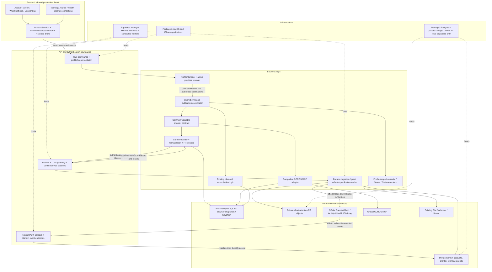
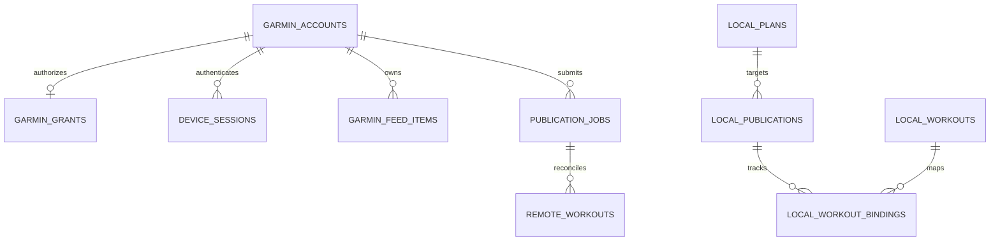
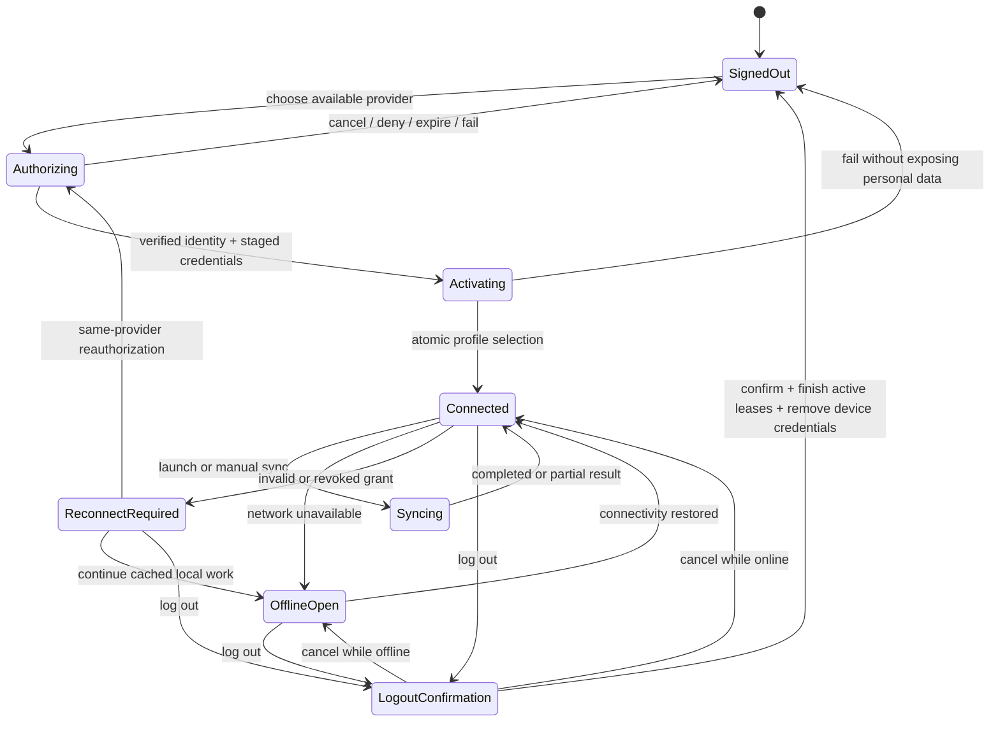

# Brand-agnostic user experience: COROS and Garmin parity

- Status: proposed implementation plan, not an implemented integration.
- Prepared: 2026-11-18; clarified with the maintainer on the same date.
- Scope: macOS and iPhone; shared-device user isolation, provider-neutral application workflows and a working Garmin adapter.

## Goal

Make Runalytics device-brand-agnostic: a COROS user can sign in, use the app and log out, then a different Garmin user can sign in on the same installation and receive the same application experience with their own data and connections. Activity ingestion, training, calendar-app publication, watch-calendar publication, Strava integration and optional device sync must follow one shared workflow rather than separate brand-specific products. A user's provider account selects an isolated persistent profile; neither the installation nor the watch model owns that profile. Garmin is the next supported adapter, while existing COROS behavior remains compatible and future brands fit the same boundaries. Equal experience means consistent workflows and honest outcomes, not fabricated proprietary metrics, identical API latency or unverified physical-watch delivery.

## Confirmed shared-device journey

1. **User A signs in with COROS.** Load only A's history, plans, preferences, retained drafts and saved external connections; publish using A's authorized destinations.
2. **A confirms logout.** Finish or safely bound active work, archive A's local profile and hide its personal workspace. Return to a neutral sign-in screen that offers every available provider, not a COROS-only reconnect screen.
3. **User B signs in with Garmin on the same app installation.** Resolve B's provider-qualified identity and open B's profile. A new B profile starts without A's activities, calendars, Strava/GitHub credentials, drafts or queued work. A returning B profile restores only B's own saved state.
4. **B uses the same app features.** Load Garmin activities/health, create and edit plans, publish to B's calendar app and Garmin Connect/watch calendar, and use B's optional Strava and device-sync connections. Only authorization, provider names and genuine capability differences vary.
5. **B logs out and A signs in again.** Restore A's saved COROS profile without importing B's data or altering A's published schedules. Repeat in either direction and across app restarts.

This is **multi-user use of one installation**, not account linking, cross-brand profile merging, simultaneous active users, or automatic migration when the same person changes brand. Several watch models attached to the same provider account do not create several users. Adding later brands is an architectural requirement, not a promise to support unimplemented providers in this release.

## Planning decisions and release gates

The shared-device journey, isolated profiles and brand-agnostic workflows above are confirmed requirements. Official Garmin access and the hosting choices below remain implementation recommendations, not approved deployments or confirmed entitlements:

- Use the **official Garmin Connect Business APIs**: Activity, Health and Training. Do not collect Garmin passwords, scrape Garmin Connect, use unofficial endpoints, or introduce a Connect IQ watch app.
- Keep **one separate profile per provider account**, matching today's COROS model and the clarified user journey. A Garmin account and a COROS account do not become the same profile because their email addresses or account IDs look alike. Linking providers, merging owned profiles and publishing to multiple wearable providers from one profile are out of scope.
- Use a **small hosted Garmin gateway** for OAuth, durable event ingestion and workout delivery. Recommend Supabase Edge Functions, private Postgres tables and private object storage, subject to maintainer approval and an operations/privacy readiness gate. Keep local SQLite as the application workspace and existing Gist sync as the optional plan-sync mechanism.
- Treat historical backfill as a parity requirement: the current initial sync asks for 30 days of activities and 14 days of health. Obtain Enterprise entitlements covering those windows, or describe a Starter release explicitly as a limited preview, not full parity.
- Missing Garmin metrics must be visibly unavailable, not fabricated. If required recovery or fitness evidence cannot be obtained or safely consumed, retain manual baselines and gate the affected functionality. Do not promise Garmin equivalents of proprietary COROS fitness/load scores.

**Before implementation against live Garmin:** confirm API access, account identifiers, scopes, payload schemas, OAuth security requirements, permitted redirects, event verification, history windows, quotas, retention terms and Training API update/removal semantics in the approved developer portal. Confirm the recommended backend with the maintainer; the separate-profile model is already confirmed. No production dashboard, secrets, deployment or permission changes are authorized by this planning task.

## Verified current state

| Area | Repository evidence | Planning consequence |
| --- | --- | --- |
| Garmin | [Garmin provider](../../../../../src-tauri/src/providers/garmin.rs) contains only unsupported operations; [Cargo features](../../../../../src-tauri/Cargo.toml) default to Garmin disabled | Enabling the flag alone cannot deliver sign-in or sync. |
| Provider abstraction | [Provider trait and factory](../../../../../src-tauri/src/providers/mod.rs) already cover reads, tracks, push and cancellation | Implement the adapter, but generalize identity, capabilities and diagnostics outside its current assumptions. Garmin must be constructed with a profile scope, not its current unscoped constructor. |
| Accounts | [Profile manager](../../../../../src-tauri/src/profiles.rs) accepts only COROS sign-in, derives profile keys from the bare COROS subject, and persists account metadata without provider identity | Garmin needs a provider-qualified identity and compatible profile metadata, not just another button. Preserve profile leases, switch serialization and stale-request rejection. |
| Presentation | [Settings](../../../../../src/desk/settings.tsx), [onboarding](../../../../../src/desk/onboarding.tsx), [app shell](../../../../../src/desk/main.tsx) and [training](../../../../../src/desk/training.tsx) invoke COROS directly | Update every entry point and help/confirmation message, not only Watch connection. |
| Startup and writes | [Native startup](../../../../../src-tauri/src/lib.rs) auto-syncs only COROS; [commands](../../../../../src-tauri/src/commands.rs) hard-code COROS for end/clear/re-push and operation stages | Centralize active-provider selection and persist the actual destination of published plans. |
| Local records | [SQLite store](../../../../../src-tauri/src/store.rs) already namespaces activities by provider/record ID and daily health by provider/day | Reuse these records; add cursor, provenance and remote-workout mappings rather than duplicate the data model. Some health/load queries select any provider and need explicit source handling for imported mixed history. |
| Cross-device plans | [Gist sync](../../../../../src-tauri/src/plan_sync.rs) reads a COROS token subject for discovery/encryption; its current wire version is 4 | Garmin-only users would otherwise have no working device sync. Preserve the COROS protocol and introduce a separately versioned Garmin identity/key path. |
| Structured workouts | [Session model](../../../../../src-tauri/src/plan/session.rs) and [FIT decoder](../../../../../src-tauri/src/fit.rs) exist | Reuse canonical session steps and FIT decoding; do not create a second training engine. |
| Hosted services | [Supabase foundation](../../../../../docs/supabase-backend.md) is explicitly inactive, with no application accounts, API, encryption or working sync | A production Garmin gateway is new work. The existing plan-head tables are not an available Garmin backend. |
| Design | [Motion contracts](../../../../design-system/motion.md), [current conventions](../../../../codebase/CONVENTIONS.md) and [verification guidance](../../../../codebase/TESTING.md) document the implemented Prism system | Reuse current tokens and shared Prism primitives. Do not reconstruct missing historical design specifications or treat superseded migration notes as current contracts. |

## Garmin platform constraints

Public Garmin documentation was checked on 2026-11-18. These are platform-level facts, not proof that Runalytics has access:

| Official source | Verified capability or limitation |
| --- | --- |
| [Program overview](https://developer.garmin.com/gc-developer-program/overview/) | Personal access is pull-only for personal activity/health data. Business Starter includes Activity, Health and Training APIs, push delivery, limited user capacity and no historical data. Enterprise adds history and push or ping/pull options; exact terms depend on access. |
| [Business FAQ](https://developer.garmin.com/gc-developer-program/enterprise/program-faq/) | Business APIs use OAuth 2.0. Detailed technical documentation is in the developer portal after access is granted. OAuth permission to read data is not automatically an OpenID Connect login service. |
| [Activity API](https://developer.garmin.com/gc-developer-program/enterprise/activity-api/) | Activity summaries and FIT data are supported. Data becomes available after the device uploads to Garmin Connect; backfill tooling is Enterprise-only. |
| [Health API](https://developer.garmin.com/gc-developer-program/enterprise/health-api/) | Daily health includes heart rate, steps, sleep and stress. Device and entitlement coverage varies. This page does not establish access to all COROS-equivalent HRV, prediction or training-load fields. |
| [Training API](https://developer.garmin.com/gc-developer-program/enterprise/training-api/) | Workouts and plans can be published to the Garmin Connect calendar after consent. Garmin Connect then synchronizes compatible devices; an API success does not prove watch delivery. |
| [Personal API](https://developer.garmin.com/gc-developer-program/personal/personal-api/) | Personal access involves generating a private API key in Garmin Connect. This is not the proposed multi-user browser sign-in and Training API publishing experience. |

There is no verified Garmin MCP interface in this plan. Do not copy COROS tool names, its FIT download quota, its JWT parsing, its fixed mobile loopback redirect, or its remote-plan replacement strategy into Garmin code.

## Requirements and parity acceptance

| Runner journey | Shared experience for COROS and Garmin | Important boundary |
| --- | --- | --- |
| Sign in | Choose an available provider from the same account screen; browser consent, bounded pending state, cancel/denial/timeout and retry | A Garmin user needs no COROS account or manual developer API key. Hide or explain unavailable providers before starting authorization. |
| Restore and switch | COROS A → logout → Garmin B → logout → COROS A, and the reverse order, restore only each user's own profile, including after restart | Same numeric subject at different providers must never collide. Logout is not account deletion or plan cancellation. |
| Onboard | Same setup, optional connections, manual baselines and plan preview for either provider | History still processing or unavailable must not strand the runner in a spinner or invent a baseline. |
| Read history | Activities, summary values, supported sports, GPS routes, laps/splits supported by existing readers and heatmaps | Treadmill/no-GPS activities are valid records. Refreshes and repaired FIT files do not create duplicates. |
| Health and fitness | Supported daily data feeds the same views, with source, freshness and missing-data handling | HRV, VO2max, thresholds, predictions and proprietary load require field-level verification. Comparable names do not establish comparable scales. |
| Train locally | Same plan creation, pain journal, completion matching, feedback and reviewed pace/difficulty workflows | Preserve current algorithms and approval rules; source adaptation is not permission to retune coaching. |
| Publish to calendar apps | Same ICS export, configured HTTPS publication and read-only subscription for either provider's plans and recorded activities | This uses the active user's calendar destination, not the wearable API. Subscription refresh is controlled by the calendar app; never reuse the previous user's URLs/credentials. |
| Publish to watch calendar | Same publish action and structured prescription, routed to the active user's COROS or Garmin adapter | For Garmin, show “Sent to Garmin Connect”; for either brand, claim watch delivery only when actually verifiable. |
| Change a schedule | Move, skip, restore, adjust and update already-published workouts through the same workflow without duplicates | Preserve dates, units, repeat steps and pace ranges; never silently flatten unsupported sessions. |
| End/clear plans | Existing confirmations, local removal, owned-provider cleanup attempt and calendar/Gist updates | Touch only the active user's Runalytics-owned remote objects. Local removal still completes if the provider is unavailable, with a retryable cleanup warning. |
| Device sync | The same provider account and GitHub Gist account restore that user's plans and provider-record completion matches on both devices | Preserve existing Gist replacement/conflict and confirmation rules, not a new cloud plan authority. |
| Strava integration | Same separate Strava authorization, newly recorded plan-paired activity matching, description updates, preserved notes and retry/review for either wearable source | Current Runalytics behavior is description enrichment, not uploading activities or bidirectional training sync. No implicit reuse of another user's Strava account; no duplicate upload pipeline. |
| Connection transfer | Same reviewed encrypted transfer flow from either provider profile | Keep provider-qualified ownership comparison and mismatch guards; never transfer OAuth sessions, sync secrets or training history. |
| Offline/recovery | An already-open profile remains usable offline; failed writes retain drafts and pending changes | Login requires online authorization. Reconnection must not silently replace local edits outside existing conflict rules. |

## Technical considerations

### System architecture

Keep the repository's actual structure: `src/desk`, `src/lib`, `src-tauri` and `supabase`. Do not reorganize into a new monorepo or introduce tRPC, Stack Auth, shadcn/ui, Zustand or React Query for this integration. Use existing React hooks/state, Tauri IPC, Rust/reqwest, SQLite and Keychain; use the existing Supabase foundation only as the starting point for a separately implemented Garmin service.

**Provider-neutral application contract:**

- **Account lifecycle owns the user.** A verified provider-qualified identity opens one persistent Runalytics profile. The installation, watch model, last selected brand and independently authorized Strava/GitHub accounts do not select or merge profiles.
- **Wearable adapters own brand differences.** COROS and Garmin implement authentication, capability discovery, activity/health normalization and structured workout/schedule translation behind the common provider boundary. Domain workflows consume canonical activities, health evidence, plans and workout steps, not COROS tool names or Garmin payloads.
- **One coordinator owns workflows.** Generalize existing native orchestration rather than add a Garmin-only sync or planning engine. It captures the active profile lease, provider identity, operation generation and each destination's credentials before doing work. Read history → persist canonical records → reconcile completions → apply existing training rules → update each authorized destination. Keep existing conflict, confirmation and error-ordering rules; each destination reports its own result, so an optional Strava/calendar failure does not undo imported activities or imply watch success.
- **External connectors are independent of watch brand.** Calendar publishing, Strava description enrichment and Gist plan sync use the same profile-scoped connectors for both providers. They must not branch on `coros` versus `garmin` to choose a user's credentials; only a wearable adapter or versioned compatibility adapter may translate brand-specific details.
- **UI consumes capabilities, not brand-specific product forks.** Shared screens/actions read available permissions and features. Provider names/logos, authorization instructions, verified constraints and diagnostics can differ; navigation, retained drafts, confirmations and workflow semantics remain common. No page-level `if Garmin then a second workflow` implementation.
- **Future adapters remain bounded.** Adding another supported brand should require its adapter, registry entry, normalization/translation and contract fixtures—not another training workspace, calendar publisher or Strava worker. Do not implement a speculative third provider now or migrate working COROS authorization into the Garmin gateway merely to make transports look identical.



**Deployment and scaling:** Garmin push delivery needs a public HTTPS receiver even when no app is open. Start with managed functions and a Postgres-backed leased work queue; no additional always-on Docker service is required unless approved API/runtime constraints demand one. Process small checkpointed batches within function limits, bound FIT downloads, and serialize grant refresh/publication per account. Scale workers horizontally using leases and unique idempotency keys; scale database/storage to measured delivery volume and Garmin's user/throughput limits. Add rate/queue/retention alarms before increasing the rollout cohort. The local Supabase CLI uses Docker for development and tests, not a promised production container architecture.

### Identity, authentication and lifecycle

1. **Provider-qualified identity.** Model an identity as provider, issuer/environment and stable provider account ID. Obtain Garmin identity through the approved authenticated API; do not parse an assumed Garmin JWT or use email, display name, device serial, access token or refresh token as identity.
2. **Compatible local profiles.** Add version/provider/issuer fields to profile metadata with a dual reader for existing COROS metadata. Keep every existing COROS directory key, browser storage namespace, Keychain scope and Gist discovery/encryption input unchanged. Derive new Garmin profile keys from a versioned, unambiguous encoding of the complete identity. Do not blindly replace the existing bare-subject hash for all users.
3. **App authentication via Garmin authorization.** The backend validates Garmin's OAuth exchange and authenticated account lookup, then issues its own short-lived, audience-bound Runalytics device session with rotating refresh credentials. These are not Garmin tokens or Supabase Auth sessions. Backend ownership is derived from the verified session, never a request's account ID or local `profileScope`. Do not add an independent email/password signup requirement.
4. **Native authorization.** Native code creates a temporary verifier/challenge and starts a short-lived backend authorization attempt. Open the returned approved Garmin authorization URL in the system browser on macOS and a platform authentication session on iPhone. Reuse the existing native authentication-session pattern where applicable. The public backend callback validates state, performs the prescribed OAuth exchange, retrieves the stable account ID and completes only that attempt. Use PKCE wherever the approved flow supports/requires it; the native-to-gateway completion must always be proof-bound.
5. **Safe app return.** Redirect through an allowlisted app link/callback supported by the approved Garmin and native registration. Return only an opaque attempt reference, never Garmin or app tokens in browser URLs or React storage. Native code exchanges its one-use attempt credentials and verifier for the app session/identity. A resume/status path handles a lost redirect without opening an arbitrary URL or activating an unauthenticated profile. Confirm exact macOS/iPhone return mechanisms in the initial spike; do not assume COROS loopback behavior is acceptable to Garmin.
6. **Atomic activation.** Keep temporary credentials separate until authorization succeeds. Acquire existing profile-switch coordination, wait for in-flight leases, prepare/open the correct profile, promote scoped Keychain entries and persist selection before emitting `account://changed`. Denial, malformed callbacks, account lookup errors or partial persistence must leave the previous profile intact; remove abandoned temporary credentials. Fence late events/results by attempt, profile and operation generation.
7. **Local logout.** Confirm, wait for active work, remove this device's credentials and hide the profile without deleting plans/history/settings or cancelling workouts. Attempt backend device-session revocation when online; local logout must work offline, remove access/refresh credentials and stop local background requests regardless of remote availability. Short access-token lifetimes bound outstanding remote sessions. Test behavior with missing/expired Keychain entries.
8. **Provider revocation/deletion.** Distinguish logout from revoking Garmin's grant. Process Garmin consent/deregistration events, stop collection/publication immediately, reject stale worker generations, remove grant material and execute the approved retention/deletion policy. Explain how to revoke at Garmin. Cached local plans remain available unless the runner explicitly chooses data deletion; do not mistake a temporary refresh failure for a different identity.

Garmin grants stay server-side, encrypted with managed key material and rotation. Store only Runalytics device credentials and the Garmin sync secret in profile-scoped native Keychain. An identifier or hash of an identifier is not an encryption secret.

### Database schema design

Proposed additions below are not migrations already present. Exact Garmin identifiers and event revisions must be finalized from approved payloads.



There are no cross-database foreign keys between cloud and local records. Remote receipts identify the owner and stable local plan/workout UUIDs; each boundary validates them.

| Store/entity | Fields, constraints and indexing |
| --- | --- |
| Cloud private `garmin_accounts` | `id uuid PK`; `environment text`, `issuer text`, `provider_account_id text NOT NULL`, unique together; `status text` constrained to active/revoked/deleting; `consent_version bigint`; wrapped random `sync_secret bytea` plus key version; creation/update timestamps. Unique identity index supports authorization lookup. |
| Cloud private `garmin_grants` | `account_id uuid PK/FK`; encrypted token envelope `bytea`, encryption-key version, granted permissions, token expiry, grant generation, refresh lease expiry and update timestamp. No browser/client-role access. Serialize rotation against the grant generation. |
| Cloud private `oauth_attempts` | Random `id uuid PK`, hashed flow credential and OAuth state, native challenge, platform/allowlisted return target, expiry, constrained status, optional authorized account FK and consumed timestamp. Expiry index; atomically consume once. No raw tokens in callback receipts. |
| Cloud private `device_sessions` | `id uuid PK`, account FK, hashed rotating refresh credential, session generation, expiry, last-use and revocation timestamps. Index account/status and expiry. Keep bounded replay detection for refresh rotation. |
| Cloud private `garmin_feed_items` | Account FK, `cursor bigint`, kind, stable external ID, upstream revision or content digest, source timestamp, ingestion timestamp, normalized JSON or private object reference, tombstone/status. Unique account/kind/external-ID/revision-or-digest for replay deduplication; account/cursor index for delta downloads. Validate account ownership before accepting data. |
| Cloud private `publication_jobs` | `id uuid PK`, account FK, local plan UUID, local revision, client mutation UUID, request hash, operation, desired generation, status, lease/retry timestamps and bounded error code. Unique account/mutation UUID; same mutation with different content is a conflict. Account/plan/generation and runnable-job indexes serialize writes and retries. |
| Cloud private `remote_workouts` | Account FK, plan/workout UUIDs, Garmin workout and schedule IDs, applied revision, payload hash, ownership marker and cleanup state. Unique owned logical workout and unique remote IDs in the account. Preserve mappings long enough to retry cleanup after local plan deletion. |
| Local `plan_publications` | Plan FK with cascade deletion, provider, opaque remote publication ID, desired/applied revision, last result. Unique plan/provider. A publication ID represents the set of Garmin workouts, not an assumed single Garmin plan slot. |
| Local `provider_workout_bindings` | Publication/workout FKs with cascade deletion, remote IDs, payload hash, desired/applied revision and delivery state. Unique publication/workout. Backend ownership mappings survive local cascades until deletion is reconciled. |
| Local `provider_outbox` | Mutation UUID PK, owning provider identity, logical plan/workout UUIDs, desired generation, operation, remote-ID snapshot, payload/hash, retry time and state. No cascading FK to a plan: cancellation intent must survive local plan deletion. Unique mutation identity; runnable-work index. Enqueue with the local edit/delete transaction, and drain only within the matching profile lease. |
| Local `provider_sync_cursors` | Provider PK in the already profile-scoped database; last committed cursor, available history range, per-stream freshness and backfill state. Commit cursor with the imported batch, never before data persistence. |
| Existing local data + provenance | Reuse activities, health, fitness, load, track and FIT retry tables. Add source/normalizer version or a keyed provenance side table only where necessary to distinguish Garmin metrics from app-derived ones; unknown fields stay nullable. Preserve provider-qualified record IDs. |

**Migration:** append numbered SQLite migrations and new timestamped Supabase migrations; do not edit existing migrations. Add backend tables in a private schema with no grants to anonymous/authenticated clients; private FIT objects have no direct public/client policies. APIs are the ownership boundary. Existing Supabase plan-head/account tables are not repurposed for Garmin or populated implicitly.

Use a staged, crash-safe metadata upgrade without moving COROS directories. Backfill existing `pushed_id` values as COROS publication bindings only for verified COROS-owned profiles, preserving the old column for compatibility. Carry provider/publication identity through Gist snapshots with an explicit compatible format strategy; keep reading existing COROS v4 snapshots and do not silently rewrite their channel or encryption. Back up fixtures before destructive migration tests; validate reopen, interrupted migration and idempotent retry. Rollback disables new Garmin work without deleting user data; never roll back by dropping populated tables.

### Proposed application API and IPC contracts

These are **Runalytics-owned API proposals**, not guessed Garmin endpoint paths. Use JSON over HTTPS, UTC timestamps and opaque identifiers. Version normalized DTOs independently of Garmin's external schema. The frontend continues calling Tauri; it does not call the gateway or receive credentials directly.

| Contract | Request and response | Authorization / errors |
| --- | --- | --- |
| `POST /v1/garmin/auth/start` | Native platform, challenge and approved return-target identifier → attempt ID, temporary flow credential, authorization URL, expiry | Pre-login; per-origin/device/network abuse limits. Backend constructs the provider URL and validates return targets; no caller-supplied arbitrary redirects. |
| `GET /v1/garmin/oauth/callback` | Garmin's approved callback parameters → browser result/app return containing only attempt reference | Validate exact state/attempt/expiry and approved OAuth proofs. Provider errors do not select a profile. |
| `GET /v1/garmin/auth/{attemptId}` | → pending/authorized/denied/expired, no account or token payload | Temporary flow credential; no enumeration or identity disclosure. |
| `POST /v1/garmin/auth/complete` | Attempt ID and native verifier → provider identity, device session, permissions/capabilities and wrapped-in-transit random sync secret | Flow credential plus challenge proof, atomically consumed. Success only after grant/account persistence. Secrets handled solely in native code. |
| `POST /v1/garmin/session/refresh` | Rotating refresh credential → replacement device credentials | Rotation/replay checks; revoked grant or session returns reconnect-required, not another account. |
| `DELETE /v1/garmin/session` | → local-device revocation result | Verified device session; idempotent. Does not revoke other devices or Garmin consent. |
| `GET /v1/garmin/connection` | → connection state, granted capabilities, stream freshness, available-history bounds, backfill status and safe diagnostics | Verified Runalytics device access token; account derived server-side. |
| `POST /v1/garmin/backfill` | Requested bounded activity/health windows → job/result or explicit unsupported reason | Device session and entitled capability. No Starter backfill promise; collapse duplicate requests. |
| `GET /v1/garmin/changes?cursor=…&limit=…` | → bounded normalized items/tombstones, next cursor and freshness | Device session; account-scoped cursor. Expired cursor returns explicit reset-required state so the client can resnapshot safely without clearing its local data. |
| `GET /v1/garmin/activities/{recordId}/fit` | → bounded FIT stream or ready/pending/unavailable outcome | Device session and account-owned record; no arbitrary URL proxy or cross-account lookup. |
| `PUT /v1/garmin/plans/{planId}` | Revision, client mutation ID, canonical workout steps and desired schedule → publication receipt/job with per-workout results | Device session, schema/size checks and expected revision. Repeat request returns the same receipt; conflicting mutation reuse fails. |
| `DELETE /v1/garmin/plans/{planId}` | Mutation ID and expected generation → cleanup receipt/job | Device session; deletes only owned remote workouts/schedules. An ended generation cannot be republished by a delayed job. |
| `GET /v1/garmin/publications/{jobId}` | → pending/partial/applied/failed, applied revision and safe actionable details | Owner session only. “Applied” means accepted in Garmin Connect, not delivered to the watch. |
| `POST /v1/garmin/events` and consent/deregistration ingress | Approved Garmin payload → contract-prescribed acknowledgement after durable acceptance | Validate precisely the sender/authentication and replay requirements in approved documentation; do not invent a Garmin HMAC signature. No end-user token required, no anonymous access to account data. |

**Typed native contracts:** extend the Rust/TypeScript mirrors together. Add optional `provider` and issuer context to `AccountSession`, capability/connection-state/history fields to `ProviderStatus`, and provider/profile/operation context to sync events. Capability states distinguish available, permission-required, unsupported and temporarily unavailable, with safe reason codes. Keep existing `connect_provider(provider)`, `disconnect_provider(provider)`, `provider_status`, `sync_now(provider)` and `push_plan_to_provider(provider)` contracts working; backend validates that a requested provider belongs to the active profile.

Add provider-neutral sign-in status/cancel and diagnostics commands; retain `coros_signin_notice` and COROS tool diagnostics as compatibility paths. Garmin diagnostics report connectivity, permissions and feed freshness, not a made-up MCP tool list. Preserve existing COROS event stage keys; add a Garmin stage rather than renaming `coros` globally. Additive optional fields must not break legacy regression fixtures.

**Errors and limits:** own APIs return stable safe error codes and retryable flags: 400 invalid input, 401 expired session, 403 missing permission/revoked grant, 409 revision/idempotency conflict, 410 expired attempt/cursor, 429 throttled with Retry-After, and 502/503 provider/service failure. Asynchronous accepted work uses 202 plus a receipt; no successful “pushed” state before actual application. Ingress acknowledgement status follows Garmin's documented contract rather than this application's conventions. Bound request/response bytes, pages and FIT sizes; respect approved rate limits with jittered backoff, bounded attempts and per-account fairness. Retry a refresh once under a lock before surfacing reconnect-required. Do not cache personalized responses in shared HTTP caches.

### Data synchronization and analytical compatibility

- Ingest durable events before acknowledgement, deduplicate replays, and normalize asynchronously. Associate events using the verified Garmin account/grant mapping, never a submitted local profile key. Late corrections and out-of-order deliveries must not overwrite newer revisions or clear existing values when a partial payload omits them.
- Persist source activity identity across summary and FIT ingestion. Reuse the FIT decoder and existing activity upsert/retry paths; add Garmin-specific download candidate selection without changing COROS-only repair SQL. Validate units, timestamps, coordinates and device-local health dates, including midnight/DST/sleep boundaries. Keep GPS-less and non-running activities without letting them inflate running mileage.
- Manual/launch sync consumes gateway deltas and entitled backfill; it is not a direct arbitrary historical pull from Garmin. Show waiting-for-Garmin and last received data separately from the time the app last checked. Persist resumable per-stream cursors and expose partial activity/health/FIT failures rather than discarding successful streams.
- Reconcile completions after activity commit; run existing adaptive/pacing workflows only against valid, sufficiently fresh evidence, preserving approval rules. Missing/denied optional health or fitness streams must not make otherwise-valid activity sync fail completely. Adapt orchestration so unsupported `sync_fitness` is an explicit skipped capability rather than today's fatal unconditional call.
- Build a field mapping before release: activity distance/time/HR/elevation and FIT details; daily steps/resting HR/sleep/stress; individually verify HRV, VO2max, threshold pace, race predictions and load. Record upstream field, unit, meaning, time window, permission/device dependency, destination and missing-data behavior for each. Unsupported values remain null with an honest UI state.
- Do not insert Garmin acute load, readiness or Body Battery into COROS-calibrated fields merely because they resemble an existing score. Reuse existing app-derived calculations only where inputs and scales are valid, label their provenance and test known cases. Otherwise disable that evidence source, leave the score unavailable and permit manual setup. Changes to coaching formulas require a separate reviewed task.
- Preserve history when consent changes; stop new collection immediately. Apply explicit tombstones according to the deletion policy without silently deleting unrelated local plans/drafts. For imported mixed-provider history, choose health/fitness/load evidence by active source and documented provenance rather than `LIMIT 1` across providers.

### Structured workout publication

Translate the canonical session steps, not presentation titles. Cover easy, long, tempo, intervals, warm-up, recovery, cool-down, repeats, race sessions, distance/time termination and pace ranges. Convert seconds/km into the exact Garmin target units in the approved specification; verify range ordering and rounding. Do not publish rest/skipped/completed sessions as new workouts.

Treat publication as reconciliation of a desired schedule with **per-workout and per-date remote IDs**. Persist a request hash, revision and ownership mapping before network side effects; retry only missing/changed work. Use Garmin idempotency facilities where available. If a create request's result is uncertain, reconcile via documented external identifiers/readback before retry; if that cannot be done safely, show a needs-review result rather than blindly create duplicates. Keep an inspectable partial-failure receipt across restarts and devices.

Update existing owned workouts/schedules in place where supported; remove only obsolete owned schedule entries. Never adopt, rename, clear or delete the runner's manual workouts or another application's objects. A newer revision supersedes older jobs, and plan ending fences all earlier push generations. Before deleting a local plan, transactionally preserve its cancellation intent and remote IDs in the non-cascading local outbox, even if the gateway is unreachable; retry through a backend cleanup receipt once online. Keep cloud cleanup jobs and mappings after local deletion, and never resurrect the plan to retry cancellation. Unsupported workout shapes must produce a reviewable error, not a silently simplified prescription. Finalize these guarantees against real API behavior in the initial spike.

### Optional cross-device plan sync

Remove COROS credential lookup from the common identity boundary, while retaining the legacy COROS path exactly. Garmin channel discovery must include provider and issuer/environment as well as the stable account identity. Generate a random high-entropy account sync secret, store it encrypted in the gateway and in scoped Keychain, and release it only following authenticated Garmin account verification on each device. Do not derive new Garmin encryption keys from public/guessable identifiers or rotating OAuth tokens; do not claim server-blind end-to-end encryption when the gateway can recover the secret.

Use a Garmin-only v5 payload/envelope with explicit provider, issuer/environment, key version and publication metadata; dispatch formats from the authenticated profile identity rather than a global switch. Keep COROS v4 reads/writes and existing channels intact, including when newer clients sync with older COROS clients. Reauthorization of the same Garmin identity must recover the same sync secret while that account's retained data exists; explicit account/key deletion must warn that remote encrypted snapshots may become unrecoverable. Specify rotation and recovery tests before release. Preserve Gist changed-snapshot authority, end-plan tombstones, user confirmations, retained unrelated drafts and known simultaneous-write limitations. Sync completion references use `(provider, providerRecordId)`, not local SQLite IDs; publication mappings remain account-bound and cannot redirect a plan to another Garmin account. Do not enable or migrate to Supabase cloud plan storage as a side effect.

### Brand-independent calendar, Strava and transfer workflows

Calendar-app publication and watch-calendar publication are **different destinations**, both driven by the same user's canonical schedule. The wearable adapter updates the user's COROS/Garmin calendar; the shared ICS connector exports or publishes the same local schedule and completions for calendar subscribers. Do not route Apple/Google/other calendar subscriptions through Garmin, make a Garmin login necessary for COROS calendar users, or mark both destinations successful because one succeeded. Preserve the existing dedicated-file replacement, configured HTTPS upload/read URLs, consent and retry behavior.

Use the shared Strava worker after activities have been normalized and paired with the local plan. Preserve its current authorization, activation cutoff, matching, existing-note protection, duplicate-description prevention and retry/review behavior for both source providers. The runner's Garmin/COROS-to-Strava activity forwarding remains configured with those services; this plan does not introduce Runalytics activity uploads, historical backfill or bidirectional Strava synchronization. Adding those is a separate scope decision, not a hidden consequence of brand parity.

Generalize QR ownership comparison from its current COROS comparison code to a versioned provider-qualified identity comparison. Keep reading existing COROS bundles; a new Garmin bundle must have an explicit version that incompatible clients reject rather than interpreting missing COROS identity as unverified permission to import. A known different provider/account is a mismatch, not evidence of the same user. Preserve explicit review and native ownership checks before applying connections; scanning before sign-in must never bypass them. An empty Garmin profile must not inherit another user's calendar URL, Strava/GitHub credentials or transfer draft.

All local timers, event consumers, query caches and outbox drains must belong to a captured profile/operation generation. Logout stops new local work for the outgoing profile and disposes its visible state; old completions cannot update the next user's screen or refresh using their credentials. Already accepted server jobs remain bound to their original account and consent lifecycle, never retargeted to whoever next signs in. Queued local changes stay with their owner until that profile is reopened. Logout does not delete previously published ICS files, revoke external subscriptions or erase workouts already on a watch; explain that boundary rather than changing existing non-destructive logout semantics.

### Frontend architecture and state flow

Use shared `ui.tsx`, `interaction.tsx`, `overlays.tsx` and semantic `tokens.css`. Keep all existing entry URLs and responsive navigation. Proposed hierarchy uses existing components, not a new provider-themed workspace:

```text
AccountScreen / Settings → Watch connection / Onboarding watch step
├── Provider choices: COROS and Garmin (shared Button/selection primitives)
├── Connection summary: active provider, state, granted features, freshness
├── Pending/cancel/retry feedback in the existing control footprint
├── Sync history and safe provider diagnostics
└── Shared confirmation Dialog: local logout / legacy import where eligible

Existing Training / Journal / Health
├── Resolve active provider and capabilities from the shared account state
├── Existing actions and notifications with accurate provider labels
└── Existing unavailable/empty/partial states, plus source/freshness explanations
```



The diagram abbreviates error returns: failed/cancelled reauthorization or logout retains the previous open profile and its prior connection state. Account switching requires logout in this first release. Never use the other connected provider or `last_provider` as an implicit fallback destination.

Update provider labels across the header sync action, onboarding/QR restore, training publish/update/end dialogs, settings directory search, diagnostics, legacy import guidance, optional Gist instructions and help. Localize new strings across the existing catalogs. Keep native disabled states, single-submit guards, visible errors, focus return, Escape/inert behavior, reduced-motion feedback and draft retention. Garmin app sessions, grant tokens and sync secrets must never enter browser storage or QR payloads. Availability comes from build/runtime configuration and verified capabilities, not a hard-coded marketing button.

### Security, privacy and performance requirements

- Validate OAuth state, attempt expiry, proof binding, exact callbacks and redirect allowlists; request fresh account selection using supported Garmin parameters rather than copying COROS-specific ones. Validate device sessions independently of provider tokens and local profile IDs.
- Keep Garmin client secrets and grant envelopes server-side, with managed encryption keys outside the database, rotation and least-privileged execution. Application bundles contain no confidential Garmin client secret. Backend service-role credentials never reach native or browser clients.
- Configure public OAuth/webhook entry points deliberately. If platform JWT verification is unsuitable for those routes, narrowly exempt them and enforce their own verification; device data routes always validate the Runalytics session. Do not treat a disabled platform check as authorization.
- Authenticate/validate inbound events according to the approved contract; restrict any ping/pull URL to approved Garmin origins and block redirects to unapproved/internal destinations. Bound JSON/FIT decoding, retries and resource usage.
- Propose rolling 35-day activity/health/FIT cache retention to serve the current 30-day initial history plus delivery grace, subject to Garmin terms and maintainer approval. Shorter raw-event retention, bounded failed-work retention and cleanup receipts need explicit documented TTLs before live collection. Expired cursor recovery must fetch an authorized snapshot, not erase older local history.
- Publish privacy/consent disclosures for hosted health processing, processors, geography, retention, revocation and deletion; provide tested purge/key-removal procedures and independently recoverable backups. Do not log tokens, health payloads, routes, callback codes or raw account identifiers. Use redacted correlation IDs, queue lag, aggregate success/failure counts and safe error categories.
- Batch local SQLite writes and commit stream cursors transactionally; preserve existing bounded track rendering. Avoid blocking the UI for all historical FIT downloads. Persist progress and resume after interruption; coalesce concurrent sync and publication requests.

## Implementation sequence

Use independently reviewable changes with the following dependencies; do not expose full Garmin availability before the final gates.

| Phase | Work and concrete repository targets | Dependency / exit criteria |
| --- | --- | --- |
| 0. Feasibility and access | Maintainer obtains official access and approves backend/privacy boundaries. Verify Garmin account lookup, redirects on macOS/iPhone, Activity/Health samples, backfill, grants/revocation and Training create/update/readback/remove behavior. Produce the field/capability mapping and workout translation evidence. Review current Prism contracts. | First gate. Stop or explicitly narrow release claims if history, identity or safe remote reconciliation cannot be supported. No fixed delivery date while entitlements are unknown. |
| 1. Provider-neutral foundation | Extend [provider contracts](../../../../../src-tauri/src/providers/mod.rs), [profile manager](../../../../../src-tauri/src/profiles.rs), [native types](../../../../../src-tauri/src/types.rs), [frontend types](../../../../../src/lib/types.ts), [IPC](../../../../../src/lib/ipc.ts), [profile state](../../../../../src/desk/profiles.ts) and [browser profile storage](../../../../../src/desk/profile-storage.ts). Generalize the shared coordinator and independently scoped destinations; preserve old profile identifiers and COROS protocol. Define reusable provider-contract tests and migration fixtures. | After phase 0 identity decisions. Existing COROS profile, calendar, Strava, logout/offline and stale-request tests pass before Garmin is wired; common workflow contracts contain no hard-coded COROS routing. |
| 2. Hosted gateway | Add private migrations/functions under `supabase` for attempts, accounts, encrypted grants, device sessions, feed cache, cleanup and idempotent publication receipts. Implement validated callbacks/event ingestion, worker leases, quotas, retention and metrics. Extend [backend documentation](../../../../../docs/supabase-backend.md) with precise deployed/not-deployed boundaries. | After phase 0 API/hosting decisions; can run alongside phase 1 using agreed DTOs. Local two-account isolation, auth replay/revocation and durable event/worker tests pass before any separately authorized staging deployment. |
| 3. Native Garmin connection and reads | Implement scoped [GarminProvider](../../../../../src-tauri/src/providers/garmin.rs); stage/promote Keychain credentials and wire approved native auth returns. Add bounded activity/health/FIT normalization using [store](../../../../../src-tauri/src/store.rs) and [FIT decoder](../../../../../src-tauri/src/fit.rs). Make [startup](../../../../../src-tauri/src/lib.rs) and [sync orchestration](../../../../../src-tauri/src/commands.rs) active-provider/capability aware. | Depends on phases 1–2. Garmin A/B/A persistence, crash/retry/expiry, initial history, partial sync and offline-open behavior pass. No live training writes yet. |
| 4. Workout delivery and all write paths | Implement translation from [canonical sessions](../../../../../src-tauri/src/plan/session.rs), publication mappings and backend reconciliation. Generalize push, automatic re-push, reschedule, skip, difficulty/pace changes, abort and clear in [commands](../../../../../src-tauri/src/commands.rs); add provider-labelled operation stages in [workspace data](../../../../../src/desk/data.tsx). | Depends on phase 3 and verified phase 0 Training semantics. Restart/retry/uncertain-result tests show no duplicate workouts; cleanup never touches unrelated Garmin data. |
| 5. Complete shared-device user journey | Generalize [account/app shell](../../../../../src/desk/main.tsx), [WatchSettings/help](../../../../../src/desk/settings.tsx), [onboarding](../../../../../src/desk/onboarding.tsx), [training](../../../../../src/desk/training.tsx) and versioned connection-transfer ownership. Implement Garmin [Gist identity/key delivery](../../../../../src-tauri/src/plan_sync.rs); verify the same calendar/Strava connectors with separately authorized users. Add localized capability, history and delivery feedback. | Depends on phases 3–4. COROS A → logout → Garmin B → logout → COROS A passes on one installation, in reverse order and after restart; the shared feature-contract suite passes for both providers. Two-device/native/live-provider validation is then required. |
| 6. Controlled release | Build with Garmin enabled only in the intended artifacts; add compile/runtime rollback controls and honest not-available states. Stage an approved test-account cohort; complete physical-device and live-provider acceptance, operations/privacy gates and documentation. | Depends on every prior exit gate. Keep COROS regression evidence and require explicit approval before production deployment or widened user access. |

### Verification plan

No application code is changed by this document; builds/browser tests are not required for the planning commit. During implementation, add only tests for the new behavior, primarily in existing suites.

**Primary acceptance scenario: one installation, two people, different brands.** Use distinct synthetic histories, plans, draft markers, calendar endpoints, GitHub identities and Strava athlete IDs for A/COROS and B/Garmin. Run it in both orders and with an app restart between logouts/sign-ins:

| Step | Required assertion |
| --- | --- |
| A signs in and uses each feature | Only A's data loads; watch writes target COROS A, ICS writes target calendar A, and Strava description writes target athlete A. |
| A logs out, including with pending work | No personal workspace remains on the neutral provider-choice screen. Already active work is settled/bounded; late A events and queued local jobs cannot be consumed as B work. No remote schedules are cancelled merely by logout. |
| New B signs in through Garmin | No A histories, plans, runner name, drafts, service settings, QR contents or notifications appear. B must authorize/configure their own optional connections; unavailable ones produce no outgoing writes. |
| B loads activities and publishes | The same UI actions operate on Garmin B and B's canonical records; B's own calendar and Strava connectors work without COROS credentials or provider-specific UI forks. Assert request destinations and owners, not just success messages. |
| A callback/result arrives while B is active | It cannot write to B's database, target B's external credentials, select A's profile, replace B's drafts or surface A's personal result. |
| B logs out and A returns | A's original profile/connection settings are restored, B's changes remain only in B's profile, and future A writes still target A's original destinations. |
| Either user signs in again offline or with an expired grant | Failed authorization never exposes the other's data. Already-open offline profiles retain existing local-work behavior; expired permissions are visible and never trigger cross-provider fallback. |

Run the same feature-contract tests against COROS and Garmin fixtures for activity import, calendar publication, watch publication/update/cancel, Strava enrichment and profile restoration. Vary only adapter inputs, permissions and documented availability; retain separate assertions for real platform limits.

- **Native profiles:** extend [profile tests](../../../../../src-tauri/src/profiles/tests.rs) for COROS compatibility, same-ID cross-provider separation, COROS A/Garmin B/A and Garmin A/COROS B/A restart cycles, interrupted activation/migration, scoped credentials, failed login rollback, offline logout and stale requests/events. Keep real Keychain checks separate from mock-credential tests.
- **Garmin adapter/gateway:** focused tests beside the new code for denial/state/proof/expiry/replay, opaque account identity, permission changes, token-refresh races, two-account isolation, duplicate/out-of-order events, transactionally committed cursors, expired-cursor snapshots, partial health failure and retained data. Add local database/function tests under `supabase/tests` and function tests with synthetic payloads, not production credentials.
- **Activity/metric normalization:** add targeted cases in existing FIT/store suites plus Garmin adapter tests for summary/FIT deduplication, repaired FIT, absent GPS, units/DST/sleep dates, omitted-versus-null fields, unsupported fitness data, provider source selection and valid completion matching.
- **Training publication:** canonical step conversion for representative easy/interval/long/race sessions, pace conversion, repeat/termination semantics and unsupported shapes; then create/update/reschedule/skip/end, timeout after remote success, duplicate mutation, worker restart, delayed older revision, concurrent devices and partial failure. Assert unrelated remote records remain untouched.
- **Browser workflow:** parameterize [profile flows](../../../../../tests/profiles.spec.mjs), [onboarding](../../../../../tests/onboarding.spec.mjs) and related [desk workflows](../../../../../tests/desk.spec.mjs) using [synthetic IPC fixtures](../../../../../tests/desk.fixture.mjs). Verify Garmin-only paths, localized labels, pending/cancel/retry, unavailable permissions/history, same-profile restore, connection-transfer exclusions, destructive confirmations and correct provider arguments for every action.
- **Prism:** run the existing [responsive matrix](../../../../../tests/prism.spec.mjs), light/dark widths 320–2560px, short/landscape viewports and enlarged text, plus targeted new sign-in/status/error states. Inspect screenshots, focus/keyboard/touch and reduced-motion behavior. Record exact verified states and native limitations with the change/release evidence; update the current context documents when contracts change.
- **Native acceptance:** live approved Garmin consent/reauthorization/revocation on macOS and physical iPhone; app suspension/return/restart, actual Keychain scoping, backfill and asynchronous data arrival; compatible watch download and step execution; offline edits/recovery and optional Gist sync on both devices; end/clear and server retry cleanup. Browser synthetic IPC tests do not establish native or Garmin integration correctness.

Use the smallest appropriate existing runner first: targeted Rust test filters and local Supabase/function tests, `node --experimental-strip-types --test tests/profile-storage.unit.mjs` for storage changes, `npm run build`, selected `npm run test:ui -- …`, and the existing i18n checker. Run the complete affected workflow/responsive set for the final cross-cutting release. Use the existing **Redesign preview** task on port 1500 for browser inspection; do not run `npm run dev` or kill unrelated listeners. Validate native builds both with and without the `garmin` feature. Future release-workflow changes must follow hosted-services guidance and require no real secrets in source.

### Release gates and rollback

Full parity is ready only when the confirmed shared-device journey passes: a COROS user can use every agreed workflow, log out, let a different Garmin user use the same app with their own data/connections, then return to their intact COROS profile. Both providers must pass the shared activity import, calendar-app publication, watch-calendar publish/update/cancel, Strava enrichment, device-sync and offline/draft-retention contracts on macOS/iPhone. A Garmin-only user must never need COROS credentials. All materially supported metrics must have a verified mapping or an explicit missing-data fallback; an unavailable core workflow is a release blocker or a clearly named limited preview, not silently accepted parity. Approval, history entitlement, native auth return, safe workout reconciliation, hosted-service operations/privacy and live-device verification are blockers, not post-release TODOs.

Keep the existing compile feature disabled by default through development and add a runtime server availability gate. Rollback must stop new consent and publication jobs, explicitly settle/stop queued work and preserve existing profiles, local plans, cleanup mappings and COROS access. Allow controlled cleanup and data export/deletion even when new Garmin onboarding is paused; do not strand already-connected users behind a hidden provider. Disabling the feature is not permission to delete their records or silently leave remote schedules active.

## Documentation deliverables during implementation

Update [README](../../../../../README.md) only when functionality ships: brand-agnostic shared-device sign-in, provider-qualified user ownership, separate optional connections, available history/metrics, calendar-app versus watch publication, existing Strava description-enrichment scope, logout/revocation, optional Gist setup and real limitations. Update backend setup with exact service/secret destinations, processing/retention and deploy/rollback steps; users enter real secrets directly into secure tools. Keep [architecture](../../../../codebase/ARCHITECTURE.md), [integrations](../../../../codebase/INTEGRATIONS.md), [conventions](../../../../codebase/CONVENTIONS.md) and [testing](../../../../codebase/TESTING.md) aligned with implemented contracts; record exact UI verification with the change/release evidence rather than reviving the retired migration ledger. Keep the Garmin-stub limitation accurate until the implementation and release gates above are complete.
